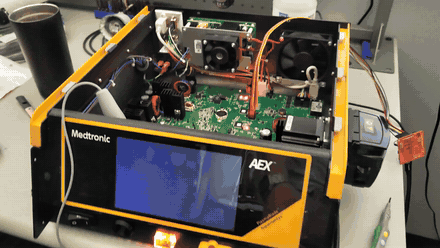

# AEX Games 🏓🗝️

Games hand-written in AVR32 assembly, running on the bare-metal CPU of a
**decommissioned Medtronic AEX electrosurgical generator**. They render on the
unit's own touchscreen, take input from its **PlasmaBlade surgical handpiece**,
use the **return-electrode (NEM) status LED** as a game indicator, and play sound
on the panel's buzzer.

- **Pong**: you against an AI paddle. The LED glows green in play and flashes red when you lose a point.
- **Raycaster**: a Wolfenstein-style first-person 3D maze. Find 3 keys to unlock
  the exit. The NEM LED works as a compass that points you to the next key.

 <!-- drop a phone screen-recording here (see media/) -->

> ⚠️ **Independent hobby / educational project. Not affiliated with, authorized
> by, or endorsed by Medtronic.** Everything here was done on a dead, out-of-service
> unit the author owns, on the bench, never connected to a patient. **No proprietary
> firmware, decompiled code, dumps, or manuals are included in this repo**: only
> original game code plus hardware-level addresses. Never run modified firmware on
> any device in clinical use.

## The gist

The generator runs an Atmel **AT32UC3C** (32-bit **big-endian** AVR32). Its
application firmware is gated at boot by a plain **CRC-32. There is no secure boot and no
signature**. So you can:

1. Append a small code blob to unused application flash.
2. Repoint one function pointer the app calls at the end of init to your blob.
3. Recompute the boot CRC.

The device then boots 100% normally and hands control to your code. Pong is
about 1.9 KB and the raycaster about 5.3 KB. It's completely reversible: reflash the
stock image and it's a generator again.

## Pong

- **Display**: drives the panel's Reach **SLCD5** serial LCD directly over USART1
  (115200 8N1) with its ASCII command set (`z` clear, `r` rect, `t` text). Clears
  the panel's power-on splash with `xd 0 255`, and renders flicker-free with
  *differential drawing* (only redraw what actually moved).
- **Input**: the PlasmaBlade handpiece's CUT / COAG buttons are read from an
  **external SPI ADC**. The stock firmware only samples that bus from a timer ISR
  (which our takeover removes), so the buffer was frozen. We **re-trigger the SPI
  bus every frame**, classify the handpiece voltage into CUT / COAG bands, and
  debounce it. Hold CUT for paddle down, COAG for paddle up. The right paddle is AI.
- **LED**: the NEM port's bicolor status LED (two active-low GPIOs, **PC31 / PD10**)
  is driven green during play and flashed red on a lost point.

## Raycaster

A 16×16 maze rendered as 40 ray columns, each 20 px wide. Walls have lit and shaded
faces and four bands of distance fog.

- **Controls (two buttons)**: you walk forward automatically and slide along walls.
  **CUT turns left, COAG turns right.**
- **Goal**: collect the 3 floating gold keys. Walls in front of a key hide it,
  column by column. The exit stays **red and locked** until the HUD reads `KEYS 3/3`.
  Then it turns green, and you walk into it to escape.
- **NEM LED compass**: green when the nearest key (or the open exit) is inside your
  60° view, red when it isn't. It blinks faster the closer you get, timed by the CPU's
  `COUNT` cycle counter.
- **Sound**: the stock firmware plays every tone (alarms, the power-on chime) on the
  SLCD5's buzzer using text commands: `bfs<Hz>` sets the pitch, `beep<ms>` plays it,
  `bvs<0-255>` sets the volume. The game uses the same commands for its key chime,
  door-open jingle, wall thud and victory tune.
- **Why it's fast enough**: the CPU is not the bottleneck. The 115200-baud panel link
  is, at about 11.5 KB/s, so it can't stream pixels. Each frame redraws only the
  columns whose height, colour or key sprite changed. A shrinking column repaints
  just the ceiling and floor strips it uncovered. Everything is integer and fixed-point:
  ray marching in 1/32-tile steps, then 5 bisection steps onto the wall face, with
  perpendicular distance to avoid the fisheye effect.
- **`game/raygen.py`** generates the tables and map (`raytab.s`). With `--preview` it
  renders a frame to PNG using the same integer math as the assembly, so you can check
  a map or constant change before flashing:
  ```sh
  python3 game/raygen.py                                # regenerate raytab.s
  python3 game/raygen.py --preview out.png 9.5 9.5 500  # x y (tiles) angle (0..1023)
  ```
  Edit the ASCII map in `raygen.py` to make your own maze (`#` stone, `B` brick,
  `K` key, `E` exit). Its self-check asserts that every key and the exit are reachable.
  `COLS` / `COLW` trade smoothness for turn speed: 80×10 looks nicer but turns at half
  the frame rate.

## Hardware map (AT32UC3C)

| What | Address / pin |
|---|---|
| App base / reset entry | `0x80010000` / `0x80010004` |
| Boot CRC word | `@0x80010000` = `crc32(app[4 : 4+0x6FFFC])`, big-endian |
| Injection hook (function pointer) | word `@0x80014AE4` → our entry |
| Blob load address (free app flash) | `0x8002C000` |
| Panel (SLCD5) USART1 | base `0xFFFF2C00` (THR `+0x1C`, CSR `+0x14`) |
| Panel buzzer | SLCD5 commands `bfs<Hz>`, `beep<ms>` (`beep0` = stop), `bvs<0-255>` |
| Handpiece SPI-ADC result buffer | RAM `0x29C4` (16 × 12-bit); re-sample routine `0x800146B8` |
| NEM LED green / red | GPIO PC31 (`0xFFFF2400` bit 31) + PD10 (`0xFFFF2600` bit 10), active-low |
| Cycle counter | AVR32 system register `COUNT` (`0x108`), CPU clock 48 MHz |

CUT / COAG bands and a couple of call addresses are per-firmware-version; the ones
above are for the unit this was developed on.

## Build & run

You need the (end-of-life) Atmel **AVR32 GNU toolchain**: `avr32-as`, `avr32-ld`,
`avr32-objcopy`. You don't need a C compiler, because the games are hand-written assembly.

```sh
# 1) assemble a game blob (pong.s or ray.s)
AVR32_BIN=/path/to/avr32-gnu-toolchain/bin  ./game/build.sh ray.s

# 2) splice the blob into YOUR OWN device's firmware image and fix the boot CRC.
#    You supply app.img (a dump of your own unit). It is NOT included here.
python3 tools/inject_patch.py --blob game/blob.bin --in app.img --out patched.img

# 3) flash over JTAG (any FTDI JTAG adapter, e.g. a Tigard), then power-cycle.
python3 tools/jtag_flash.py write --i-have-a-backup patched.img
```

After power-on the panel ignores commands for about 5 s, so both games re-send their
screen setup a few times before starting. `tools/jtag_peek.py` and `tools/jtag_dump.py`
read registers / RAM over JTAG; they were the workhorses for the reverse-engineering.

## Files

- `game/pong.s`: Pong (physics, AI, SLCD5 rendering, handpiece input, NEM LED).
- `game/ray.s`: the raycaster (rendering, key sprites, compass LED, buzzer sound).
- `game/raygen.py` / `game/raytab.s`: raycaster table + map generator, and its output.
- `game/nemsweep.s`: a safe GPIO sweep used to find the LED pins on the bench.
- `game/inject.ld`: links the blob at its load address.
- `tools/inject_patch.py`: drops the blob into free flash and recomputes the boot CRC.
- `tools/jtag_*.py`: flash / read the chip over JTAG (FTDI-based adapter).

## License

[MIT](LICENSE). Applies to the original code in this repository only.
